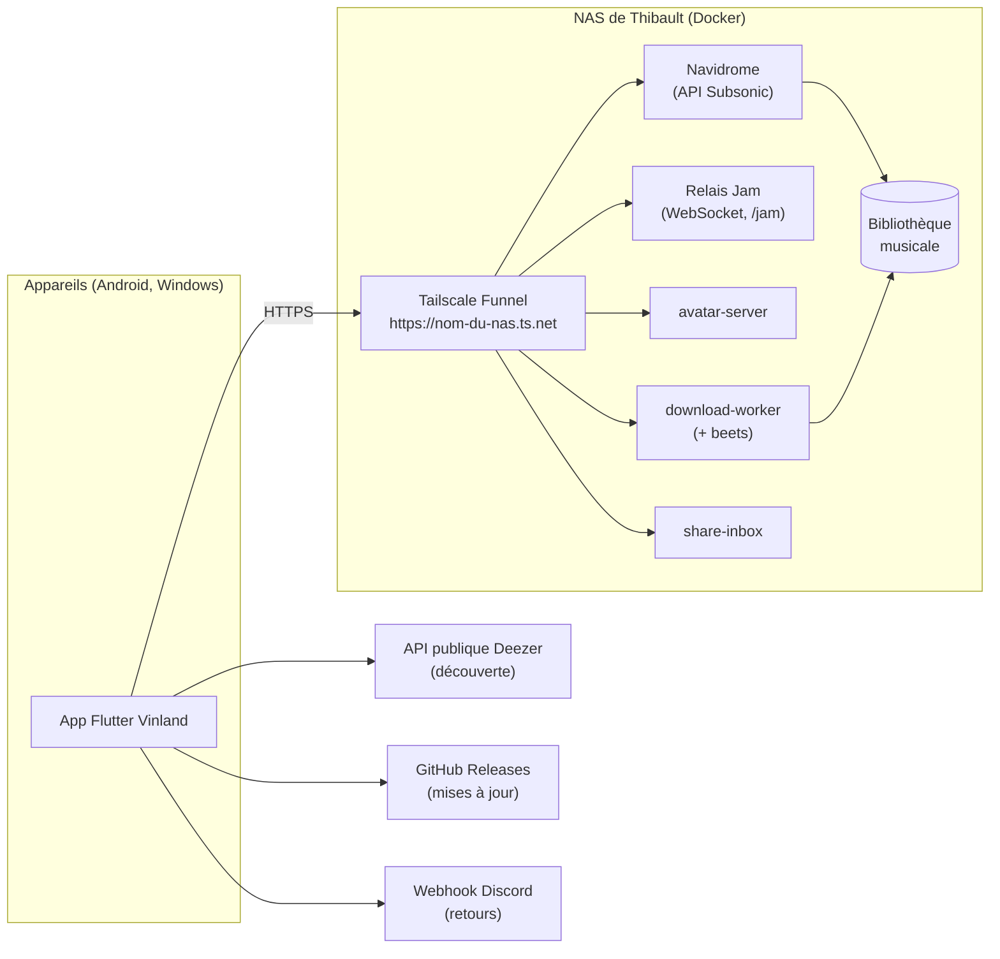
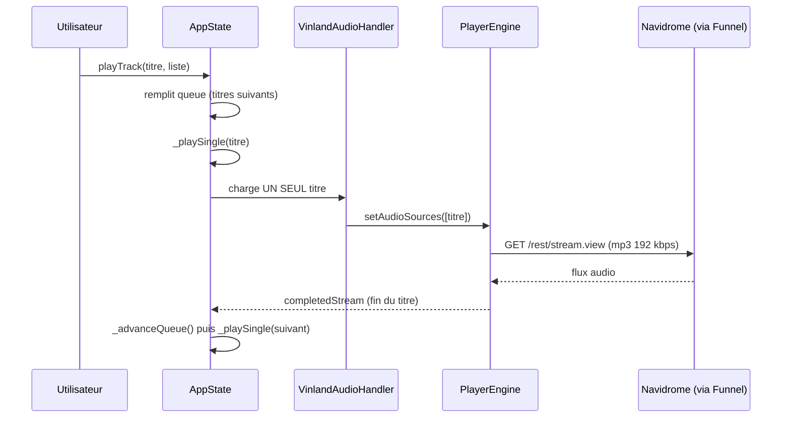
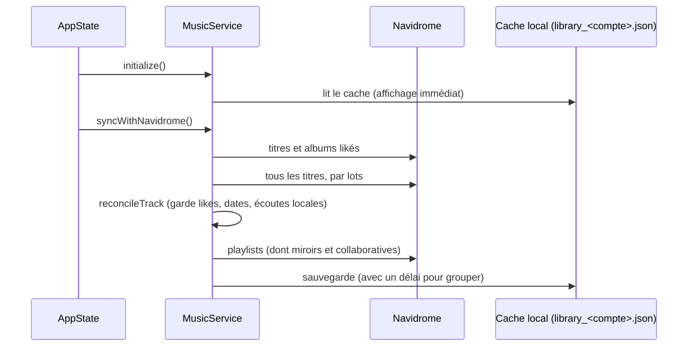
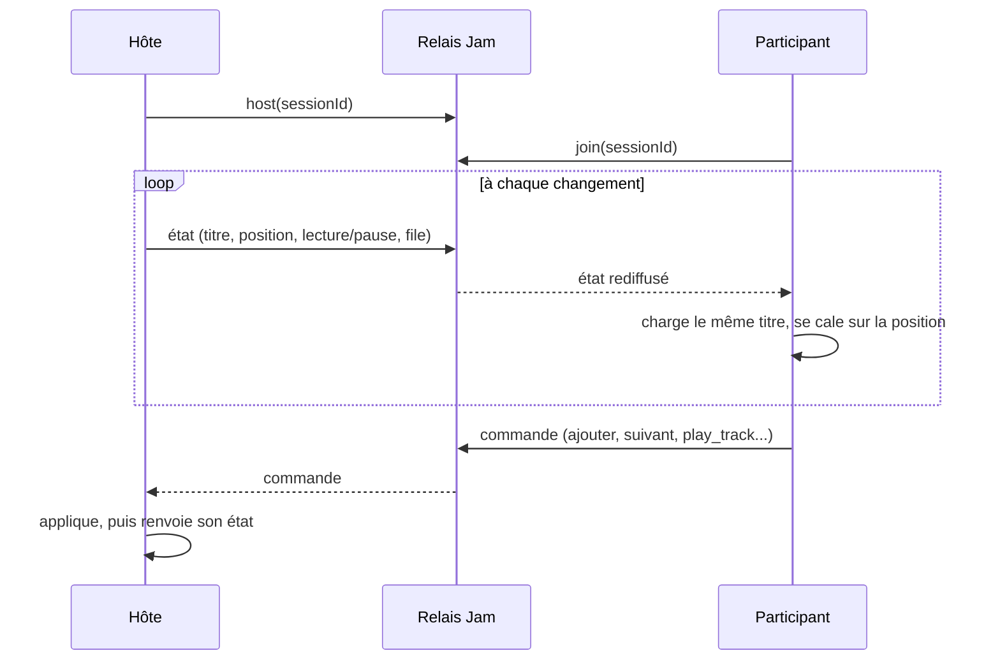

# Architecture de Vinland

Ce document explique comment les morceaux de Vinland s'emboîtent, pour
qu'une personne (ou une nouvelle session Claude) puisse s'y retrouver sans
lire les 30 000 lignes de code. Les choix structurants sont détaillés dans
les [ADR](adr/).

## Vue d'ensemble

Tout ce qui est sur le NAS passe par **un seul nom d'hôte** exposé par
Tailscale Funnel ([ADR 0004](adr/0004-tailscale-funnel.md)) : aucun port
de la box n'est ouvert.

## L'app Flutter

Une seule base de code pour Android et Windows. Les dossiers `ios/`,
`macos/`, `linux/` et `web/` viennent du modèle `flutter create` : ils ne
sont **ni construits ni testés** (voir le README).

| Couche | Où | Rôle |
|---|---|---|
| Écrans mobiles | `lib/screens/` | Interface téléphone (onglets Accueil, Bibliothèque, Amis). |
| Écrans desktop | `lib/desktop/` | Interface Windows (barre latérale, panneaux). Choisie par `main.dart` selon la largeur de la fenêtre. |
| Widgets partagés | `lib/widgets/` | Lecteur, mini-lecteur, tuiles, dialogues. |
| État | `lib/providers/app_state.dart` | `AppState` (`ChangeNotifier` + `provider`) : file d'attente, Jam, amis, mises à jour. Point d'entrée unique des écrans. |
| Services | `lib/services/` | Accès réseau et disque, sans widget. |
| Modèles | `lib/models/` | `Track`, `Album`, `Playlist`, `FriendProfile`... |
| Config secrète | `lib/config/` | Gitignorée, régénérée en CI (voir `CLAUDE.md`). |

### Rôle de chaque service

| Service | Rôle |
|---|---|
| `NavidromeService` | Client Subsonic : connexion, titres, albums, playlists, URL de lecture et de pochette. |
| `MusicService` | Bibliothèque locale : cache JSON par compte, likes, écoutes, hors-ligne, playlists (dont collaboratives), playlists miroirs pour les amis. |
| `PlayerEngine` | Interface commune aux deux moteurs audio : `JustAudioPlayerEngine` (Android) et `MediaKitPlayerEngine` (Windows). Voir [ADR 0001](adr/0001-media-kit-sous-windows.md). |
| `VinlandAudioHandler` | Pont `audio_service` : notification, écran verrouillé, boutons du casque. |
| `JamService` | Client WebSocket du relais Jam (écoute à plusieurs, synchro perso entre ses propres appareils). |
| `DiscoveryService` | Recherche Deezer pour afficher ce qui n'est pas encore sur le NAS. |
| `MatchingService` | Dit si deux titres ou artistes sont « les mêmes » (accents, featurings...), utilisé partout. |
| `DownloadWorkerService` | Demande au NAS de récupérer un titre manquant puis de le retaguer. |
| `ShareInboxService` | Boîte de réception des partages entre amis. |
| `AvatarService` | Photos de profil (Navidrome n'en a pas). |
| `StreamingImportService` | Import CSV d'une playlist d'une autre plateforme. |
| `UpdateCheckService`, `SelfUpdaterService`, `AndroidUpdaterService` | Détection et installation des nouvelles versions publiées sur GitHub. |
| `FeedbackService` | Envoie un retour utilisateur sur Discord. |
| `DeepLinkService` | Liens `vinland://track/<id>` (et `album`, `playlist`) ouverts depuis une autre app. |
| `SharingConsent` | Choix de partage avec les amis et consentement (voir [confidentialité](confidentialite.md)). |

## Flux d'une lecture

- La file d'attente vit **en Dart** dans `AppState.queue` ; le moteur ne
  reçoit jamais qu'un titre ([ADR 0003](adr/0003-un-seul-titre-dans-le-moteur.md)).
- Un titre téléchargé est lu depuis le disque (`MusicService.getOfflinePath`),
  sinon il est streamé, transcodé à 192 kbps ([ADR 0006](adr/0006-transcodage-192-kbps.md)).
- Les boutons suivant/précédent de la notification passent par
  `customActionStream` pour rejoindre la même logique.

## Flux d'une synchro de bibliothèque

Le cache est propre à chaque compte : changer d'utilisateur vide l'état en
mémoire et annule les envois en attente, pour ne jamais pousser les likes
d'un compte vers un autre.

## Flux d'un Jam

- Modèle **hôte-autoritaire** : seul l'hôte envoie un état, les
  participants n'envoient que des commandes.
- Le relais ne voit ni la musique ni les comptes : c'est un pub/sub en
  mémoire, par session.
- Inviter un ami en un tap passe par la playlist miroir « titre en
  cours » de l'hôte, nommée `Jam:<sessionId>`
  ([ADR 0005](adr/0005-playlists-miroirs-pour-le-social.md)).
- La sécurisation du relais (secret d'hôte, limites) est en cours dans la
  PR de la session 05.

## Intégration continue et releases

- `.github/workflows/ci.yml` : à chaque PR, formatage, `flutter analyze
  --fatal-infos`, tests de l'app et du relais.
- `.github/workflows/release.yml` : sur un tag `vX.Y.Z`, rejoue la CI puis
  construit l'APK Android et le zip Windows (runner `windows-2022`, voir
  [ADR 0002](adr/0002-runner-windows-2022.md)) et publie la release.
- La procédure complète est dans `CLAUDE.md`.
